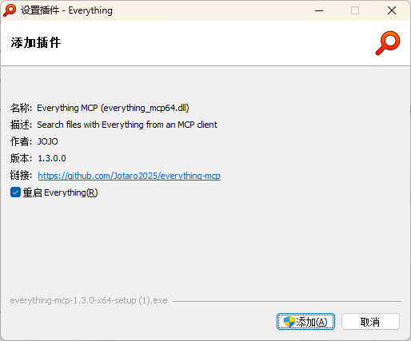
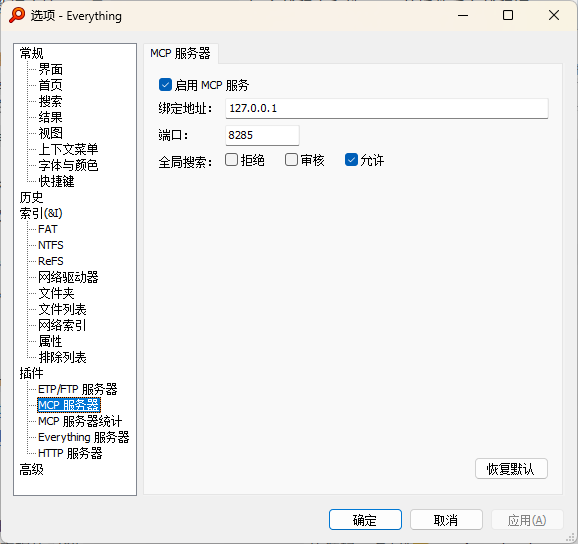
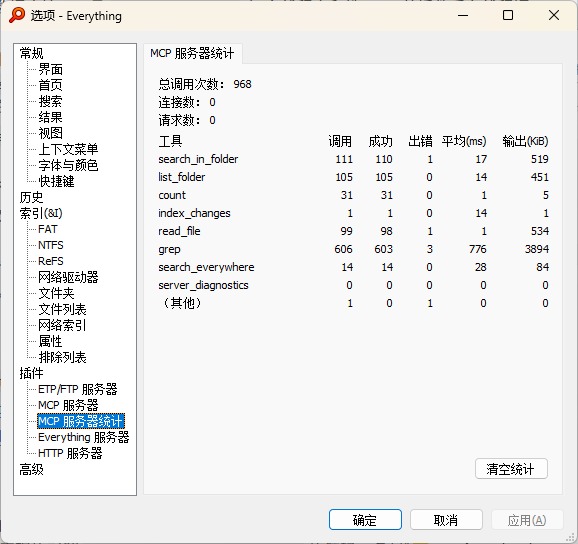

<h1 align="center">everything-mcp</h1>

<p align="center">
  <strong>Everything 1.5 进程内 MCP 插件</strong><br>
  把本机文件搜索能力以 Model Context Protocol 暴露给 Cursor、Claude Desktop 等 LLM 客户端。
</p>

<p align="center">
  <a href="https://github.com/Jotaro2025/everything-mcp/stargazers"></a>
  <a href="https://github.com/Jotaro2025/everything-mcp/forks"></a>
  <a href="https://github.com/Jotaro2025/everything-mcp/releases"></a>
  <a href="https://github.com/Jotaro2025/everything-mcp/releases/latest"></a>
  <a href="LICENSE"></a>
  <a href="https://www.rust-lang.org/"></a>
</p>

<p align="center">
  <a href="https://github.com/Jotaro2025/everything-mcp/releases/latest"></a>
  <a href="#安装"></a>
  <a href="docs/mcp-tools.md"></a>
</p>

<p align="center">
  <a href="README.en.md">English</a> |
  <a href="docs/mcp-tools.md">工具详解</a> |
  <a href="docs/PLUGIN_SDK_API_CN.md">插件 SDK</a> |
  <a href="RELEASE_NOTES.md">发行说明</a>
</p>

<p align="center">
  <a href="https://linux.do/"></a>
</p>

> [!NOTE]
> 需要已安装 [Everything 1.5](https://www.voidtools.com/)。插件默认只监听 `127.0.0.1`，且默认关闭 MCP 服务，需在选项中手动启用。

## 为什么选择 everything-mcp

| 能力 | 说明 |
|---|---|
| 进程内插件 | 单个 `everything_mcp64.dll`，由 Everything `LoadLibrary` 加载，无外部进程开销。 |
| 零第三方 DLL | 除 Windows 系统库外不引入额外 DLL；Rust/`serde`/CRT 全部静态链接。 |
| 文件夹优先 | 工具以「在指定目录内搜索」为主，降低全局噪声；可选全局按名搜索并三档管控。 |
| 图形设置页 | 在 Everything 选项里直接改启用开关、绑定地址、端口、全局搜索档位，点「应用」即时生效。 |
| 双时代 MCP | 同一端点同时服务 2024-11-05（`initialize`）与 2026-07-28（`_meta` + `server/discover`）。 |
| 可打包安装 | 官方同款 `-setup-plugin` 机制，一键产出 x64 / x86 安装包。 |

## 截图

### 安装：添加插件

<p align="center">
  
</p>

运行安装包后，Everything 弹出「添加插件」对话框，确认名称 / 版本后点「添加」。

### 配置：MCP 服务器选项

<p align="center">
  
</p>

在 **选项 → 插件 → MCP 服务器** 勾选启用，设置绑定地址、端口与全局搜索档位（拒绝 / 审核 / 允许）。

### 统计：MCP 服务器调用数据

<p align="center">
  
</p>

**选项 → 插件 → MCP 服务器统计** 可查看各工具调用次数、成功率、平均耗时与输出体积。

## 安装

### 方式一：安装包（推荐）

1. 从 [Latest Release](https://github.com/Jotaro2025/everything-mcp/releases/latest) 下载与 Everything 位数匹配的安装包：
   - `everything-mcp-*-x64-setup.exe`
   - `everything-mcp-*-x86-setup.exe`
2. 运行安装包 → 在「添加插件」对话框点 **添加**（可勾选「重启 Everything」）。
3. 打开 **选项 → 插件 → MCP 服务器**，勾选 **启用 MCP 服务**，点「应用」。

<details>
<summary><strong>方式二：手动复制 DLL</strong></summary>

```text
把编译产物 everything_mcp.dll 改名为 everything_mcp64.dll
放入 C:\Program Files\Everything\Plugins\
```

重启 Everything。Everything 1.5 按 `<name>64.dll` 约定加载 64 位插件。

</details>

<details>
<summary><strong>方式三：从源码构建 / 打包</strong></summary>

```powershell
# 构建 DLL（仅需 Rust / rustup MSVC 工具链）
cargo build --release
cargo test

# 一键打 x64 + x86 安装包（另需 VS C++ 桌面工作负载、Windows SDK、7-Zip 或 Python）
cd installer
powershell -ExecutionPolicy Bypass -File build-installers.ps1
# 产物：installer\dist\everything-mcp-*-x64-setup.exe 等
```

</details>

## 配置

| 配置项 | 类型 | 默认值 | 说明 |
|---|---|---|---|
| `mcp_enabled` | int | `0` | 0 关闭（默认）；1 启用 MCP HTTP |
| `mcp_bind` | string | `127.0.0.1` | 绑定地址（建议仅本机） |
| `mcp_port` | int | `8285` | HTTP 监听端口 |
| `mcp_global_search` | int | `0` | 全局搜索：`0` 拒绝 / `1` 审核 / `2` 允许 |

设置保存在 `%APPDATA%\Everything\Plugins.ini` 的 `[everything_mcp64.dll]`（或 32 位 `everything_mcp32.dll`）小节。也可在选项页修改，点「应用」立即生效，无需重启 Everything。

### MCP 客户端接入

把下面片段合并到 Cursor / Claude Desktop 等 MCP 配置（只需一个 URL）：

```json
{
  "mcpServers": {
    "everything": {
      "url": "http://127.0.0.1:8285/"
    }
  }
}
```

端点是双时代的：老客户端走 `initialize` 握手，新客户端可直接请求。完整协议说明见 [docs/mcp-tools.md](docs/mcp-tools.md)。

## MCP 工具

接入后 LLM 会发现以下 8 个工具：

| 工具 | 作用 |
|---|---|
| `search_in_folder` | 在指定文件夹内按 Everything 语法递归搜索（支持排序 / 翻页 / 时间戳） |
| `list_folder` | 列出文件夹内容 |
| `count` | 统计匹配数量（轻量） |
| `index_changes` | 查询索引变更（创建 / 修改 / 删除 / 重命名 / 移动） |
| `read_file` | 读取单文件正文（行窗口 / 大小上限；敏感路径黑名单） |
| `grep` | Everything 选候选 + 正则逐行匹配 |
| `search_everywhere` | 全局按名搜索（受 `mcp_global_search` 三档管控，默认关闭） |
| `server_diagnostics` | 服务诊断与运行统计 |

参数范例、`content:` 提速、翻页与排错见 **[工具详解](docs/mcp-tools.md)**。

### 手动验证

```powershell
# legacy：initialize 握手
curl -s -X POST http://127.0.0.1:8285/ -H "Content-Type: application/json" -d "{\"jsonrpc\":\"2.0\",\"id\":1,\"method\":\"initialize\",\"params\":{\"protocolVersion\":\"2024-11-05\",\"capabilities\":{},\"clientInfo\":{\"name\":\"curl\",\"version\":\"0\"}}}"

# modern：server/discover
curl -s -X POST http://127.0.0.1:8285/ -H "Content-Type: application/json" -H "MCP-Protocol-Version: 2026-07-28" -d "{\"jsonrpc\":\"2.0\",\"id\":1,\"method\":\"server/discover\",\"params\":{\"_meta\":{\"protocolVersion\":\"2026-07-28\"}}}"
```

## 仓库结构（简）

```text
everything-mcp/
├── src/                 插件入口、选项页、搜索 / MCP HTTP
├── installer/           官方同款安装包构建脚本与 setup 启动器
├── docs/                SDK、工具详解、截图
├── tests/               MCP 协议层集成测试
└── reference/           voidtools 官方 C 插件参考（不参与编译）
```

## 已知限制（摘要）

- HTTP 端点只接受 **POST JSON-RPC**；**不实现 SSE**，`GET` 返回 405。
- 面向本机 LLM 客户端；绑定非回环地址时请自行评估暴露面。
- `search_everywhere` 默认拒绝，需在选项中改为审核或允许。

更多见 [docs/mcp-tools.md](docs/mcp-tools.md)。

## 社区

欢迎在 [LINUX DO](https://linux.do/) 交流与反馈：

<p align="center">
  <a href="https://linux.do/"></a>
</p>

也欢迎 Star、提 Issue / PR，或参与测试。

## 许可

- 本仓库自有代码：[MIT](LICENSE)
- Everything 为 voidtools 产品，名称与图标归其版权方所有；本项目与 voidtools 无隶属或官方背书关系。
